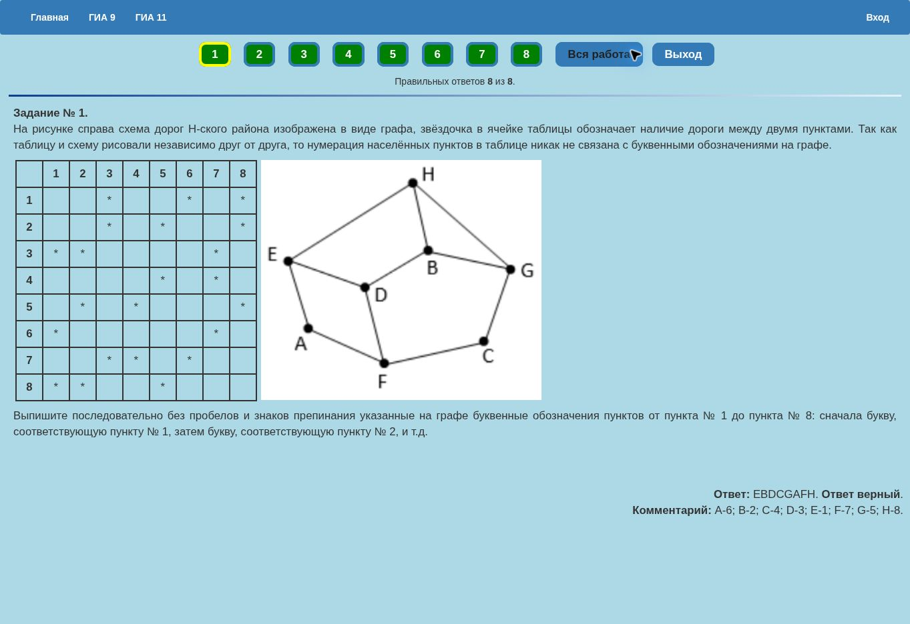

# ГР-вася — без сервера

Расширение Manifest V3 для Яндекс Браузера на Linux и Windows. Основной сайт — https://vgaranov.ru/. На сайте Гаранова используются текст, формула и таблицы текущего задания. Поддерживаемые логические задачи вычисляются локально; остальные отправляются с изображением **напрямую в GigaChat**. Своего сервера и Render нет.

## Использование

- Ctrl+Shift+Y показывает / скрывает маленькое окно. Значок расширения делает то же самое.
- Введите пароль в этом окне и нажмите «Войти».
- Перетащите окно за ручку над кнопкой.
- «Решить» заново читает текущее задание. Для распознанных шаблонов логики вычисляет ответ локально; иначе делает новый снимок без окна, обрезает его до области задания при возможности и передаёт модели текст, формулу и таблицы вместе с изображением. В окне появляется только итоговый ответ.
- Перейдите к следующему заданию и снова нажмите «Решить».
- При скрытии ответ удаляется. Уже отправленный запрос может завершиться, но его ответ не показывается после повторного открытия.
- После полного перезапуска браузера пароль нужен снова. На старте расширение не снимает страницы и не обращается к ИИ.

## Однократная подготовка владельцем

Нужен **Node.js 22+**: https://nodejs.org/. Никаких npm-пакетов устанавливать не нужно.

Из корневой папки проекта в PowerShell:

```powershell
powershell -ExecutionPolicy Bypass -File .\prepare-extension.ps1
```

Флаг относится только к запускаемому процессу, постоянные настройки не меняются. Скрипт локально и скрыто запросит:

1. Ключ авторизации GigaChat из вашего кабинета — **без префикса Basic**, не краткоживущий access token.
2. Пароль разблокировки, который вы выбрали. Пароль не записан в исходниках и проверяется успешностью расшифровки.

Скрипт создаст `extension/private-key.vault.json` и `dist/gr-vasya-0.7.0.zip`. Ключ и пароль в открытом виде на диск не записываются. Зашифрованный файл и архив исключены из Git.

Для проверки загрузите папку `extension/` через режим разработчика в `browser://extensions`, обновите вкладку с заданием и нажмите Ctrl+Shift+Y. Для магазина используйте ZIP из `dist/`. На другом компьютере нужен только установленный пакет и пароль — Node.js там не требуется.

Если модель недоступна вашему аккаунту, выберите доступную модель с поддержкой изображений в `extension/config.js`, затем повторите `node tools/build.mjs`. Бесплатные лимиты зависят от вашего аккаунта GigaChat, проект их не гарантирует.

## Как защищён ключ

AES-256-GCM, 128-битный тег аутентичности, случайная соль 32 байта и nonce 12 байт. Ключ шифрования получается из пароля через PBKDF2-SHA256 с 1 200 000 итераций. Для каждой упаковки создаются новые соль и nonce. Формат проверяется до расшифровки. Пароль не сравнивается с константой в коде.

После разблокировки ключ находится в памяти профиля браузера (`chrome.storage.session`, доступ `TRUSTED_CONTEXTS`). Содержимому сайта ключ не возвращается. В `storage.local` или `storage.sync` открытый ключ не сохраняется. В настройках расширения есть кнопка блокировки.

**Короткий пароль остаётся перебираемым офлайн.** Много итераций замедляет подбор, но не делает короткий пароль надёжным. Скачавший расширение получает зашифрованный ключ и может пытаться его расшифровать. Исходный пароль в проекте не зашит. После разблокировки владелец компьютера может получить ключ через инструменты разработчика. Шифрование не скрывает ключ от человека, который знает пароль и контролирует браузер.

## Прямое подключение и сертификаты

Расширение запрашивает доступ только к `api.giga.chat` и `ngw.devices.sberbank.ru` для запросов API. Сам снимок отправляется после явного нажатия. Загрузка снимков в хранилище GigaChat сопровождается запросом удаления после получения ответа, включая ошибки. Сбой сети может помешать удалению.

Браузер должен доверять TLS-сертификатам обоих API. В некоторых системах требуется настройка официальных сертификатов НУЦ Минцифры по документации GigaChat: https://developers.sber.ru/docs/ru/gigachat/certificates . Расширение не устанавливает сертификаты и не отключает проверку TLS. Без доступа к порту 9443 и доверия сертификатам прямое подключение не заработает.

Авторизация и загрузка ограничены 25 секундами; генерация принимается потоком с общим лимитом 90 секунд. Для краткой вычислительной проверки модели выделяется до 2048 выходных токенов, в окно выводится только строка FINAL_ANSWER. Незавершённый ответ не выдаётся за полный. Доступность модели и действительность ключа проверяются реальным запросом при решении, а «Войти» проверяет расшифровку локально.

## Тесты и статус

`npm test` — шифрование, неверный пароль, повреждение файла, сценарий входа без вкладок, отсутствие запросов на старте, повторные снимки, адресаты API, удаление файлов при ошибке и сборка ZIP без открытых секретов. Тесты API используют имитацию ответов.

Без вашего ключа реальное решение GigaChat проверить невозможно. Проверка установки и сетевого доступа в фактическом Яндексе на Linux, иконки, реальные скриншоты и модерация магазина ещё нужны. Публикация в магазине не выполнена.

## Улучшение точности в 0.6.0

`task-context.js` читает только видимый блок `#div_question` на vgaranov.ru. Таблицы передаются с сохранением пустых ячеек; скрытые ответы, состояние сайта и исполняемые скрипты не читаются. На других сайтах остаётся снимок видимой области. PNG используется без потери качества текста.

`logic.js` содержит строгий парсер булевых формул без eval и два ограниченных вычислителя: минимальная длина отрезка A для формул принадлежности известным отрезкам и восстановление единственного порядка столбцов фрагмента таблицы истинности. Для первого проверяются все границы и интервалы между ними; для второго — все перестановки переменных и совместимость различных строк. Если шаблон не распознан, решения нет или порядок неоднозначен, вычислитель возвращает управление ИИ и ничего не угадывает. Это не универсальный решатель всех задач.

Регрессионный пример из сообщения пользователя: P=[298;349], Q=[168;363], R=[214;430] и ((x∈Q)∧¬(x∈A))→¬(((x∈P)→¬(x∈R))∧(x∈Q)): ответ 195. Тесты также сравнивают вычислитель с независимым перебором границ. Повышение оценки на всём варианте 1-oge/1-log ещё не проверено реальными запросами: ключа владельца в среде разработки нет.

При обновлении через git pull уже упакованный private-key.vault.json сохраняется, так как исключён из Git. При скачивании новой папки перенесите этот зашифрованный файл из предыдущей папки extension. Для повторной сборки ZIP достаточно node tools/build.mjs — ключ заново вводить не нужно.

## Поддержка 1-sr10 в 0.7.0

Добавлены строгие вычислители для минимальной длины слова при заданных кодах Фано, минимального числа уровней прозрачности с учётом сжатия, объёма одинаковых аудиозаголовков, числа пользователей при посимвольном хранении паролей и площади пересечения/объединения двух прямоугольных следов Черепахи с поворотами на 90 градусов. Все параметры извлекаются из текущего текста, готовых ответов или привязок к номеру варианта в расширении нет. Неподдерживаемые шаблоны передаются модели.

Для графов модель получает исходную картинку диаграммы, если доступно её чтение в canvas; иначе используется снимок. Модель перечисляет вершины и рёбра, а graph.js проверяет изоморфизм с таблицей. Для симметричных графов ответ принимается только если все найденные сопоставления дают один результат. При несовпадении связей выполняется одна повторная попытка распознавания. Две попытки могут расходовать больше токенов; ошибочно прочитанные буквенные метки, дающие допустимое сопоставление, всё ещё могут привести к неверному ответу.

Исправлено дублирование вложенных таблиц оформления, отдельно сохраняются блоки алгоритмов pre. Распознавание изображений по-прежнему зависит от модели; наличие графового вычислителя само по себе не гарантирует оценку 8/8.

В отдельном проверочном сеансе разработчика на vgaranov.ru самостоятельно рассчитанные ответы были приняты на 8/8; эти входные данные используются в регрессионных тестах. Это контрольная проверка формул и формата, а не полный прогон расширения с реальным ключом GigaChat.


