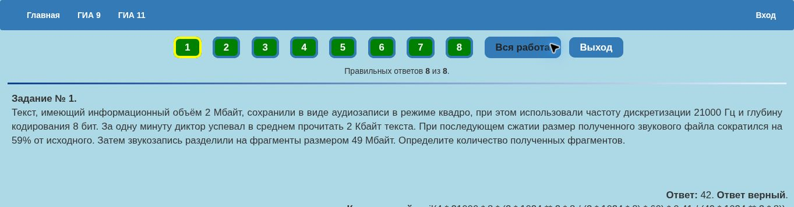

# ГР-вася 1.0.0

Помощник для vgaranov.ru в Яндекс Браузере на Linux и Windows. **Сначала вычисляет локально. Для неподдерживаемого случая предлагает «Отправить в GigaChat» — автоматической отправки нет.** Сервер не нужен.

## Работа

- Ctrl+Shift+Y или значок расширения показывает / скрывает окно справа сверху.
- При первом открытии после перезапуска браузера введите свой пароль.
- «Решить» читает текущее условие, формулу, таблицы и алгоритм. Поддержанные шаблоны вычисляются программно.
- Для задач с файлами кнопка может скачать открытый XLSX/TXT по ссылке в условии и обработать его локально.
- Если тип не распознан, появляется отдельная кнопка «Отправить в GigaChat». Только она разрешает снимок и обращение к ИИ.
- Графы на картинках требуют распознавания GigaChat по этой кнопке. Полученные связи проверяются и сопоставляются с таблицей локально.
- Повторное нажатие «Решить» читает новое задание. Окно перетаскивается за ручку сверху. При скрытии ответ и предложение отправки очищаются.

[Таблица покрытия всех 23 подтипов ГИА 11](docs/gia11-coverage.md)

## Подготовка владельцем — один раз

Установите Node.js 22+ с https://nodejs.org/ . Из корня проекта в PowerShell:

```powershell
powershell -ExecutionPolicy Bypass -File .\prepare-extension.ps1
```

Скрипт скрыто запросит ключ авторизации GigaChat **без префикса Basic** (не краткоживущий access token), затем выбранный пароль разблокировки. Не присылайте ключ в чат. Флаг ExecutionPolicy действует только на запускаемый процесс.

Результаты: `extension/private-key.vault.json` и `dist/gr-vasya-1.0.0.zip`. Открытый ключ и пароль не записываются на диск; зашифрованный файл и ZIP исключены из Git. Пароль не зашит в исходниках: его проверяет расшифровка.

Для разработки загрузите папку `extension/` через режим разработчика в `browser://extensions`. Для публикации используется ZIP. На другом компьютере Node.js не нужен — только установленный пакет и пароль.

## Обновление

Если проект клонирован Git: `git pull`. Файл `extension/private-key.vault.json` сохраняется, потому что не отслеживается Git. Если скачиваете новую папку, перенесите этот файл из предыдущей папки `extension/`.

Обновите расширение в `browser://extensions` и перезагрузите вкладку с заданием. Повторно вводить API-ключ не нужно. Чтобы пересобрать ZIP с прежним зашифрованным ключом:

```powershell
node .\tools\build.mjs
```

## Проверки выпуска

`npm test` — 43 теста, в том числе 78 текстовых примеров из генераторов сайта, шифрование, сборка, извлечение условий, явная отправка в ИИ и чтение XLSX. При разработке дополнительно проверены шесть запросов к реальным XLSX/TXT-файлам сайта.

На восьми новых заданиях с новыми параметрами вычислители дали результат **8/8 на самом сайте**. Проверка выполнена запуском тех же модулей локально и вводом вычисленных ответов через браузер. Это проверка вычислителей, а не установка упакованного расширения в Яндекс/Linux. Настоящее распознавание графов GigaChat в этой среде не проверялось — ключ владельца здесь не хранится.



## Границы поддержки

Реализованы описанные в таблице шаблоны, а не произвольные программы и любые формулировки ЕГЭ. Генераторы сайта могут выдавать новые разновидности; для них остаётся явная кнопка GigaChat. Проверки на конечной выборке не гарантируют 100% правильных ответов на всё содержимое сайта. Особые ограничения: Черепаха — два прямоугольника и повороты по 90°, комбинаторика — распознанные условия соседства, поиск X в длинных выражениях — ограниченный перебор; распознавание графов зависит от модели.

Файловым задачам нужны доступ к `https://vgaranov.ru/download/` и современный Chromium с `DecompressionStream('deflate-raw')` (заявлен минимум Chromium 114). Чтение файлов ограничено по домену, типу и размеру; внешние XML-сущности и исполняемый код не используются.

Для GigaChat нужны доступная аккаунту модель с изображениями, токены, сеть и доверие TLS-сертификатам API. Модель выбирается в `extension/config.js`. Бесплатные лимиты не гарантируются проектом. Если есть ошибка сертификата, используйте официальную инструкцию https://developers.sber.ru/docs/ru/gigachat/certificates . Расширение не устанавливает сертификаты и не отключает проверку TLS.

## Защита ключа

AES-256-GCM с 128-битным тегом, случайной солью 32 байта и nonce 12 байт. Ключ шифрования получается из пароля через PBKDF2-SHA256, 1 200 000 итераций. При каждой упаковке соль и nonce меняются.

После разблокировки открытый ключ хранится в памяти профиля браузера (`chrome.storage.session`, `TRUSTED_CONTEXTS`), не в `storage.local`/`storage.sync` и не в ответах странице. В настройках есть кнопка блокировки. Скрытие панели не отменяет уже отправленный запрос.

Короткий пароль остаётся перебираемым офлайн: шифрование замедляет подбор, но не скрывает ключ от человека, знающего пароль и контролирующего браузер. Пакет содержит зашифрованный ключ, поэтому распространение ZIP также распространяет его зашифрованную копию.

## Публикация

[Чек-лист магазина](docs/publishing.md). Исходники версии 1.0.0 готовы к локальной проверке; публикация, финальная политика конфиденциальности и модерация магазина ещё не выполнены.
